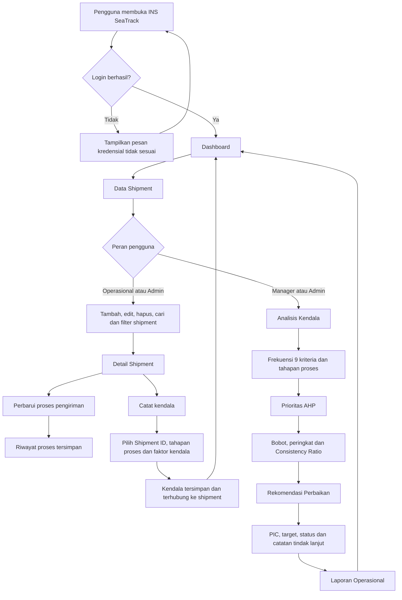
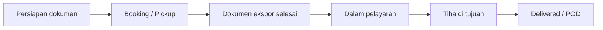
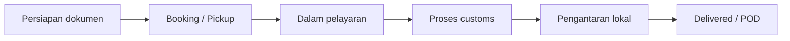
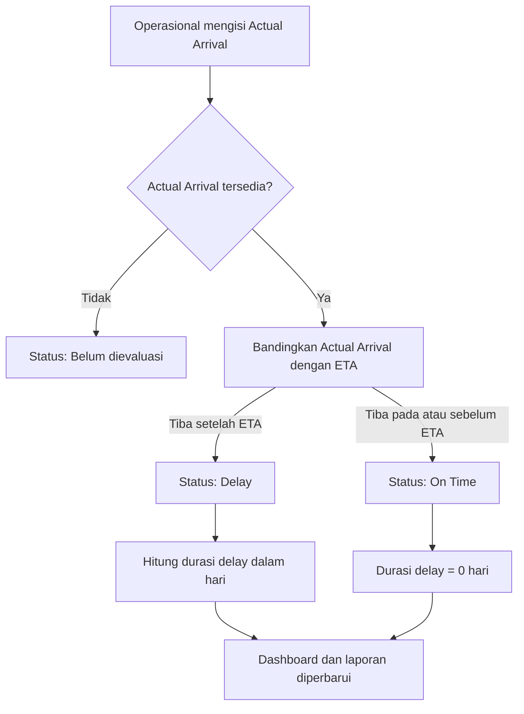

# Flowchart Sistem INS SeaTrack

## 1. Alur utama sistem

## 2. Alur proses shipment

Setiap pembaruan tahap mewajibkan catatan proses. Nomor dokumen dan lampiran dokumen bersifat opsional. Tahap tidak dapat dilompati agar riwayat pengiriman tetap valid.

### Arus outbound (OE)

### Arus inbound (OI)

## 3. Alur penentuan status shipment

## 4. Alur hak akses

| Peran | Akses utama |
|---|---|
| Operasional | Kelola shipment, proses pengiriman, status actual arrival, dan kendala. |
| Manager | Analisis kendala, hasil AHP, rekomendasi perbaikan, dan laporan. |
| Administrator | Seluruh akses operasional dan manajerial. |

